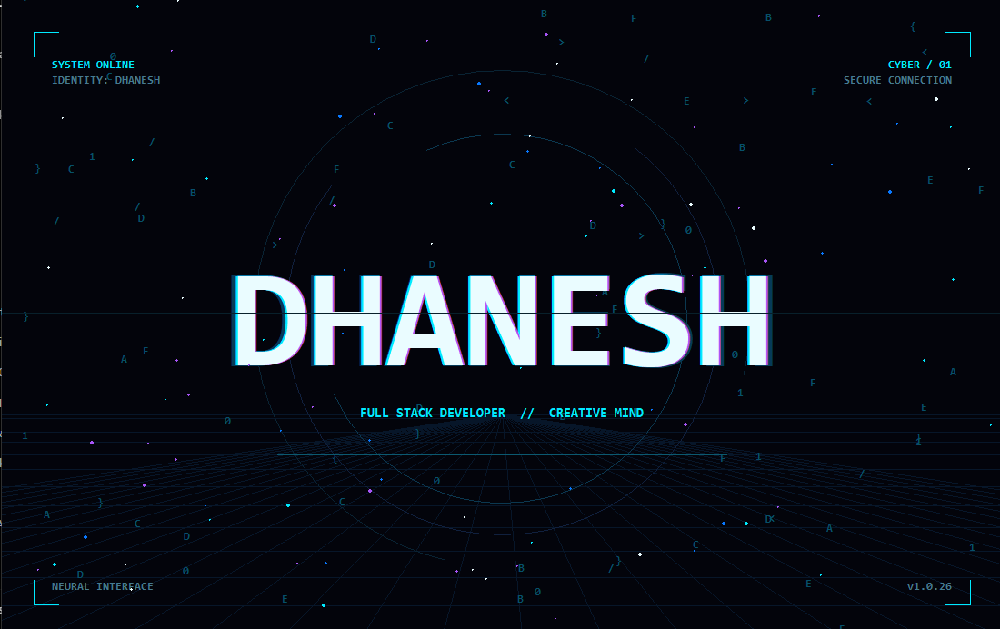

# DHANESH.exe — Cyber Identity

A futuristic cyberpunk desktop animation built with Python and Tkinter, featuring neon typography, digital rain, a rotating HUD, and interactive glitch effects.



## ✨ Features

- Animated neon typography with cyan, violet, and white highlights
- Digital rain with randomly generated characters
- Futuristic HUD with rotating circles and technical readouts
- Perspective grid with animated scanlines
- Floating particles and interactive glitch bursts
- Responsive interface that adapts to window resizing
- Keyboard and mouse interaction

## 🛠️ Built With

- Python 3
- Tkinter
- Canvas-based animation
- Python standard library

## 🚀 Getting Started

### Prerequisites

- Python 3.10 or newer
- Tkinter (included with most standard Python installations)

### Installation

Clone the repository:

```bash
git clone https://github.com/YOUR_USERNAME/dhanesh-cyber-identity.git
cd dhanesh-cyber-identity
```

Run the application:

```bash
python dhanesh_cyber.py
```

No additional Python packages are required.

## 🎮 Controls

| Control | Action |
|---|---|
| Left mouse click | Trigger glitch and particle burst |
| Spacebar | Trigger glitch and particle burst |
| Resize window | Adapt the animation to the new dimensions |

## 📸 Preview

Add your screenshot as `assets/screenshot.png` and an animated preview as `assets/demo.gif`.

## 📄 License

Distributed under the MIT License. See [LICENSE](LICENSE) for details.

---

Created by **Dhanesh M V**.
